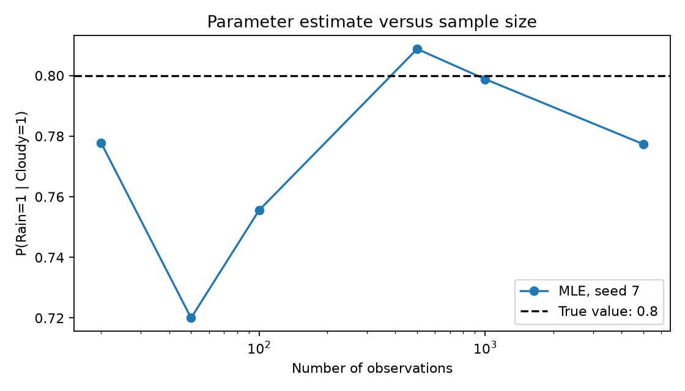

# BN: Hands-on (1) — Building and Learning a Bayesian Network

**Course:** CS F407 Artificial Intelligence

**Name:** Darshan Prakash Rajagoli

**Quanta:** Week 6, BN: Hands-on (1)

## 1. Model and assumptions

We use four binary variables: Cloudy (C), Rain (R), Sprinkler (S) and
WetGrass (W). State 0 means false and state 1 means true.

```text
        Cloudy
       /      \
     Rain   Sprinkler
       \      /
        WetGrass
```

The joint distribution is:

`P(C,R,S,W) = P(C) P(R|C) P(S|C) P(W|R,S)`.

Rain and Sprinkler are conditionally independent given Cloudy. WetGrass is
conditionally independent of Cloudy once Rain and Sprinkler are known.
These are modelling assumptions, not claims that all real weather works this way.

### Reference conditional probability tables

| Quantity | Probability |
|---|---:|
| P(C=1) | 0.50 |
| P(R=1 given C=0) | 0.20 |
| P(R=1 given C=1) | 0.80 |
| P(S=1 given C=0) | 0.50 |
| P(S=1 given C=1) | 0.10 |
| P(W=1 given R=0,S=0) | 0.01 |
| P(W=1 given R=0,S=1) | 0.90 |
| P(W=1 given R=1,S=0) | 0.90 |
| P(W=1 given R=1,S=1) | 0.99 |

For each parent configuration, the state-0 probability is one minus the state-1
probability. Each CPT column therefore sums to one.

## 2. Constructing the network and exact inference

[sprinkler.py](sprinkler.py) builds the graph and CPTs using `pgmpy`.
`VariableElimination` computes the posterior distributions. For example:

`P(R=1 | W=1) = sum over c,s of P(c)P(R=1|c)P(s|c)P(W=1|R=1,s) / P(W=1)`.

The denominator sums the same expression over both Rain states as well.
The result is **0.704769230769**.

An independent function enumerates all 16 assignments of the four binary
variables using the probability specification directly. It agrees with the
library for every reported query. The tests additionally compare all 16 joint
probabilities, so a correct answer to one query cannot hide a different CPT.

## 3. Homework: change the query

The qualitative predictions below follow from the graph and supplied CPTs.
They are checked against both variable elimination and independent enumeration.
The baseline is the prior probability of the query variable.

| Query variable | Evidence | Prior | Prediction | Posterior |
|---|---|---:|---|---:|
| Sprinkler | W=1 | 0.30 | Increases: sprinkler use makes wet grass more likely | 0.427846153846 |
| Cloudy | W=1 | 0.50 | Increases: cloudy weather strongly increases rain, although it reduces sprinkler use | 0.574615384615 |
| Rain | W=1,S=0 | 0.50 | Increases strongly: the sprinkler is excluded as a cause of wet grass | 0.992202204894 |

For comparison, knowing only W=1 gives P(R=1|W=1)=0.704769230769.
Adding S=0 increases it further. It is not exactly one because the model permits
wet grass with neither rain nor sprinkler, with probability 0.01.

## 4. Learning parameters by maximum likelihood

The graph stays fixed. We generate 1,000 complete observations using seed 7.
Each observation samples C, then R and S conditional on C, then W conditional
on R and S. This is ancestral sampling from the specified joint distribution.

The program fits all CPTs using maximum likelihood estimation (MLE).
For example:

`estimated P(R=1|C=1) = count(R=1,C=1) / count(C=1)`.

For the 1,000 observations, 502 have Cloudy=1 and 401 also have Rain=1.
The manual estimate is **401/502 = 0.798804780876**, equal to the library result.
The program prints both estimates and asserts that they agree. Full learned CPTs and actual
counts are in [results.txt](results.txt). Binary state names are supplied
explicitly so a state absent from a small dataset is not silently removed.

### Effect of sample size

The experiment uses N = 20, 50, 100, 500, 1,000 and 5,000, with seed 7.
The true value of P(R=1|C=1) is 0.8. The output records each estimate and its
absolute error.

| N | Estimated P(R=1 given C=1) | Absolute error |
|---|---:|---:|
| 20 | 0.777778 | 0.022222 |
| 50 | 0.720000 | 0.080000 |
| 100 | 0.755556 | 0.044444 |
| 500 | 0.808765 | 0.008765 |
| 1,000 | 0.798805 | 0.001195 |
| 5,000 | 0.777375 | 0.022625 |



Larger samples generally make estimates more stable. A particular estimate is
not guaranteed to improve every time N increases: sampling variation remains.
The same seed and sampling order make the smaller datasets prefixes of the
larger ones in this implementation. Numerical results need not match the
course notebook's simulator because the random sampling implementation differs.

## 5. Sparse data: MLE versus Bayesian estimation

Both estimators use the **same 30 observations, seed 11**. MLE uses observed
frequencies. Bayesian estimation uses a BDeu prior with equivalent sample size
10, distributed uniformly over each node's parent/state configurations.

For Rain, there are two Cloudy configurations and two Rain states. Each Rain
CPT cell receives `10 / (2*2) = 2.5` pseudo-counts. Therefore:

`BDeu P(R=1|C=1) = (count(R=1,C=1)+2.5) / (count(C=1)+5)`.

On this dataset, MLE gives **0.588235** and BDeu gives **0.568182**.
The true value is 0.8, so in this particular case smoothing moves the estimate
further from the truth. The test suite checks the formula against the fitted model. The results file
prints both fitted models' CPTs. BDeu avoids zero probabilities due solely to
missing observations and pulls estimates toward the uniform prior. It is not
guaranteed to be closer to the true value 0.8 on every dataset.
For a completely unobserved parent configuration, MLE is not identified;
`pgmpy` fills that row uniformly. Such a row is not evidence learned from data.

## 6. Classroom exercise: interpret the WetGrass CPT

For `evidence=["Rain", "Sprinkler"]`, columns are ordered as follows:

| Column | Rain | Sprinkler | P(W=0) | P(W=1) |
|---|---:|---:|---:|---:|
| 1 | 0 | 0 | 0.99 | 0.01 |
| 2 | 0 | 1 | 0.10 | 0.90 |
| 3 | 1 | 0 | 0.10 | 0.90 |
| 4 | 1 | 1 | 0.01 | 0.99 |

The last parent, Sprinkler, changes fastest. Rows give WetGrass states 0 and 1.
Changing this ordering without rearranging probabilities changes the model.
The tests verify every complete assignment against the mathematical specification.

## 7. Classroom exercise: different datasets

The program generates N=100 observations separately for seeds 1, 2, 3, 4 and 5,
fits an MLE model to each, and records estimated P(R=1|C=1). The five estimates
are shown below; the true parameter is 0.8.

| Seed | Estimated P(R=1 given C=1) |
|---|---:|
| 1 | 0.727273 |
| 2 | 0.836735 |
| 3 | 0.897959 |
| 4 | 0.725490 |
| 5 | 0.714286 |

Different samples contain different counts, so their estimates differ. This is
sampling variability. Repeating the same seed reproduces the same dataset;
different seeds are not expected to give identical estimates.

## 8. Validation: two failures worth distinguishing

**Invalid probabilities:** one Rain column is deliberately changed to
`[0.9, 0.3]`. Its sum is 1.2, so `check_model()` rejects it.

**Valid probabilities with wrong meaning:** the WetGrass CPT is deliberately
changed to put state-1 probabilities `[0.01, 0.90, 0.99, 0.90]` in the four
columns. All columns still sum to one, so `check_model()` passes. However,
P(R=1|W=1) changes to **0.717295226871**. Independent inference checks catch this.

A program running successfully and its CPTs being normalized are necessary
checks, but neither guarantees that it represents the intended model.

## 9. Reproduce and check

From this folder:

```bash
python -m pip install -r requirements.txt
python sprinkler.py
python test_sprinkler.py
```

The practical writes `results.txt` and `sample_size.png`. Captured test output
is in [test_results.txt](test_results.txt): **8 tests passed**. Tests cover the graph, all joint
assignments, all homework posteriors, MLE counts, the BDeu formula, sparse binary
states, both validation failures and reproducible datasets.

The original course notebook is preserved separately under `../source/`.
Its saved outputs belong to that supplied reference; the results here are from
running this standalone implementation.

Implementation reference: [pgmpy parameter estimation documentation](https://pgmpy.org/guides/parameter_estimation.html).
